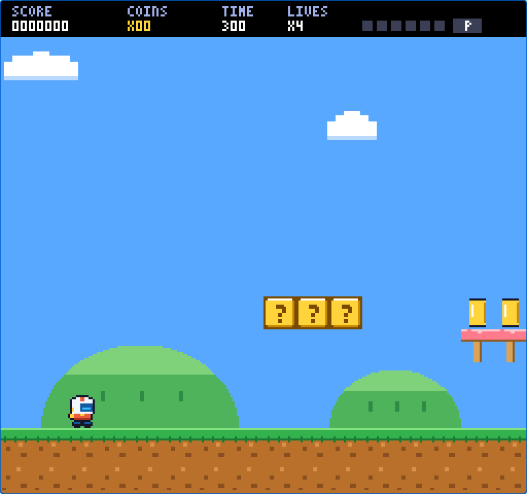
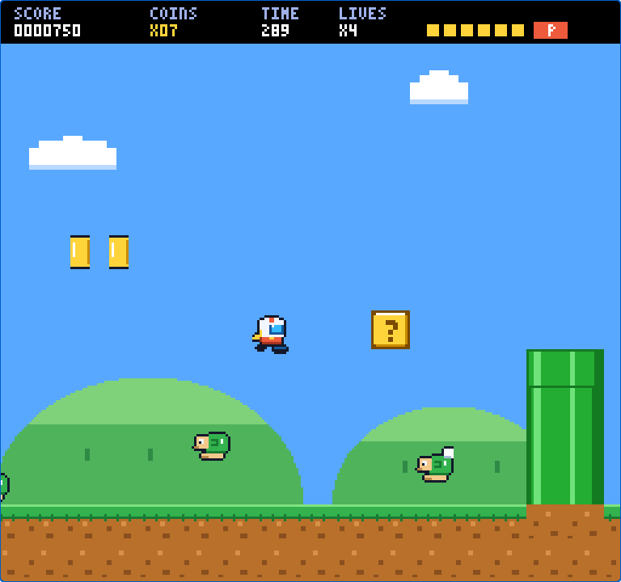
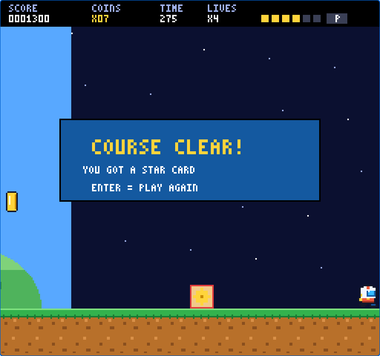

# Courier

A browser platformer with classic console-era physics, **built and verified against a numeric spec** by a
deterministic Playwright harness. One complete course (a tutorial-style "grassland" level) with enemies,
blocks, a power-up, a switch, a goal card, a timer and a score, all drawn in code. There is no build step
and no runtime dependency.



| | |
|---|---|
|  |  |

## Play it

```bash
git clone <this repo> courier && cd courier
npm start                      # serves the repo root on http://127.0.0.1:4173/
```

Open <http://127.0.0.1:4173/>. Any static file server works as well, because the game is `index.html` +
`game.js` + `render.js`.

| Key | Action |
|---|---|
| ← / → (or A / D) | Move |
| Z (or Shift / J) | Run (hold). Reach full speed to fill the P-meter |
| X (or Space / K) | Jump (hold for a higher jump) |
| ↓ | Crouch (big form, visual only) |
| Enter | Retry / play again |
| M | Mute |

Add `?debug` to the URL for a frame/velocity readout.

## What is in the box

- **The game** (`index.html`, `game.js`, `render.js`): a fixed-timestep simulation (60.0988 Hz), integer
  1/16-pixel physics, tile collision, one-way platforms, five enemy types, bumpable blocks, a growth item,
  a P-switch, a timer (41 frames per unit), a goal card roulette, a pixel-art renderer and synthesised sound.
- **The spec** (`spec/`): every physics number with a source and a confidence label, plus a list of conflicts
  between sources and how each was resolved.
- **The verification harness** (`harness/`, `tools/`): 91 deterministic tests that drive the game frame by
  frame through a small hook (`window.__smb3`) and check it against the spec: physics, gameplay rules, pixel-level
  visual constraints, and a lookahead planner that proves the course is completable.
- **All iterations** (`iterations/`): frozen, playable snapshots of earlier builds with their scores, so you can
  see how the build improved and replay any step. The newest iteration is the repo root.

## Host it for free

The game is a static site, so any static host works. Two ready-made options:

- **GitHub Pages**: in the repo, *Settings → Pages → Source: GitHub Actions*. The `deploy-pages` workflow publishes the
  game and `iterations/` on every push to `main` at `https://<user>.github.io/<repo>/`.
- **Vercel**: *Add New → Project → import the repo*, leave every build setting empty (`vercel.json` handles it) and
  deploy. Netlify and Cloudflare Pages work the same way: no build command, publish directory `.`.

## Verify it

```bash
npm install
npm run install:browsers       # one-time: downloads Chromium for Playwright
npm run verify                 # runs all suites, prints a score per group, exits 1 on any failure
```

```
root build  91/91
  physics (timing, horizontal, deceleration, vertical, pmeter, stomp)   35
  gameplay (course-frame, course-layout, enemies, blocks, goal)         37
  visual (style, sprites, motion, hero)                                 19
```

See [docs/VERIFICATION.md](docs/VERIFICATION.md) for how the loop works and
[docs/MAINTAINING.md](docs/MAINTAINING.md) for how to change the code safely.

## Iterations

| Iteration | Recorded score | What changed | Play |
|---|---|---|---|
| 1 | 71/87 | Physics ported onto a tile world, full course, basic rules, rectangle art | [iter-01](iterations/iter-01/index.html) |
| 2 | 71/87 | Fairer landing zone on the raised ledge | [iter-02](iterations/iter-02/index.html) |
| 3 | 86/87 | Pixel-art sprites, flat NES-style palette, bitmap font, visual test suite | [iter-03](iterations/iter-03/index.html) |
| 4 | 87/87 | Planner hooks: completability proven by search | [iter-04](iterations/iter-04/index.html) |
| **5 (root)** | **91/91** | 12-pose hero with new proportions, hero visual tests | [index.html](index.html) |

Scores are recorded against the suite as it existed at that time (see `iterations/scoreboard.json`).
Serve the repo and open `/iterations/iter-NN/` to play an older build.

## Working with Claude Code

This repo is set up so a Claude Code session can pick up the work: read [CLAUDE.md](CLAUDE.md), then run
`/verify`. It explains the verification loop, the guardrails and the open backlog.

## Legal

- Licensed under the [MIT License](LICENSE).
- **Original work.** All art, sound and level design are original and generated in code. The characters are
  original creations. The project contains no code, sprites, audio, ROM data or level data from any commercial
  game, and contributions must not add any (see [CONTRIBUTING.md](CONTRIBUTING.md)).
- The physics spec cites public technical documentation of 8-bit console platformers for *behavioural numbers
  only* (speeds, gravity, timers). Console and game names that appear in the docs are trademarks of their
  respective owners and are used only to identify those references. This project is not affiliated with,
  endorsed by or sponsored by any game publisher or console maker.
